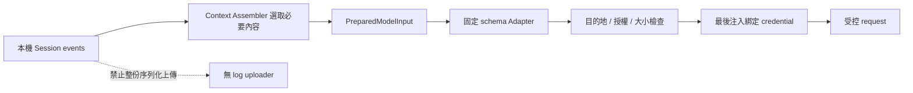

# 資料外傳與權限政策

## 1. 必須滿足的要求

**OpenSprite Harness 不得包含向 DeepSeek／參考專案服務傳送資料的機制。**

這包括對話、原始碼、工具參數／結果、Session events、路徑、附件、回饋、使用行為、硬體資訊、device/user id、crash report、帳號與更新檢查。禁止把原 sender 保留在預設 disabled 狀態，等待某次組合、fallback 或版本更新意外啟用。

這是產品需求。以下條目是建議的實作政策，尚未實作／驗證。

### 完全不建立的部件

- DeepSeek provider adapter 與預設 baseURL。
- dsh_session_log extension、Session uploader、acceptance watermark。
- OTel／analytics／crash-report exporter、遠端 feedback sender。
- diagnostics outbox、延遲補送、歷史重傳或遠端 collector 設定。
- DeepSeek 帳號、搜尋 provider、產品更新器與原始 runtime 下載器。
- 可在背後建立 sender 的原 bundle、profile 或 @deepseek-ai/dsh-* 產品相依套件。
- 從原產品複製設定／使用者資料的自動遷移程式。

回饋先只作本機事件。若未來要支援寄送到 OpenSprite Harness 自己的服務，必須另提需求、審查資料 schema 與授權；不能以目前「通用擴充」方式預留入口。

## 2. 保證分層與威脅模型

| 層級 | 能說明的事 | 不能推論的事 |
|---|---|---|
| 設計限制 | 自有程式沒有上報功能，外連有明確政策 | 依賴或任意子程序一定不聯網 |
| 測試證據 | 指定 build／平台／流程中只看到允許的連線 | 所有未測情境與惡意程序都被阻擋 |
| 執行環境強制 | OS／容器對指定程序群實際限制出口，且通過測試 | 遠端服務不會再轉送，或同使用者的惡意程序無法篡改系統 |

第一版針對本機單人使用、不可信模型輸出、repo／檔案內容、網頁文字及網路輸入作防護。不宣稱能抵禦已控制同使用者帳號／管理員的惡意程序。

產品畫面應顯示目前實際保障：哪些出口受 broker 控制、哪些程序受 OS 限制、哪些能力不可用。不能只用一個綠色 sandbox enabled 表達所有情況。

## 3. Outbound Broker

### 3.1 唯一網路入口

自有 Host 程式、provider adapter、內建網路工具若將來加入，必須走 OutboundBroker。

傳入的是 destination_id、purpose、受控 payload、run authorization；不接受模型提供的任意 URL、任意 headers 或 proxy。只有 Host 設定管理能新增 destination。

建議第一版只有 purpose=model_inference。UI、事件保存、評分、錯誤、取消、退出與重啟都沒有可發送用途。startup 不進行版本檢查、DNS warmup、模型列表掃描或自動 connection test。

### 3.2 Destination 結構

| 欄位 | 用途 |
|---|---|
| destination_id | 本機穩定 id |
| kind | loopback-model／approved-remote-model |
| scheme/host/port/base_path | 正規化後的精確目的地 |
| allowed_methods/routes | 固定 inference 路徑，非整個 host 任意 API |
| credential_ref | 與該目的地綁定；不存原始 key |
| model_id | 明確選擇的模型 |
| operator_approval | 由人類設定的授權及 revision |
| upstream_assurance | local-controlled／direct-reviewed／relay-unverified |
| limits | request size、timeout、並行及重試預算 |

尚未選擇實際 provider，文件不附可直接發送的預設雲端設定。所有目的地初始為空；missing config 明確報錯。

### 3.3 固定規則

- 遠端 inference 只接受明確批准的 HTTPS origin、port、path；HTTP 僅限明確的 loopback model。
- 拒絕 URL userinfo、片段、混淆 host、非預期 scheme／port；正規化後再精確比對。
- 預設拒絕 3xx，不自動追 redirect。未來若允許，每一跳都重新核對目的地，跨 origin 不帶原 credential。
- 不自動繼承 HTTP_PROXY／HTTPS_PROXY／ALL_PROXY／PAC。未來 proxy 必須獨立核准與顯示；將目的地判斷交給 proxy 時要標示信任界限。
- 憑證在最後核對目的地後才注入。變更 endpoint／port／path 或 binding 需重授權，不把既有 key 自動送給新服務。
- 重試不能切換 provider、endpoint 或 model；政策撤回使尚未發送／重試的請求失效。
- cancel／撤權時嘗試 abort 活躍請求，但已送資料不可撤回。
- DNS、IP family 與連線建立須避免驗證後重新解析：remote 禁止 private／link-local／loopback 及映射繞過；loopback 類別只接受明確本機 IP，固定 port，不使用可被外部解析的 hostname。
- 對解析結果、TLS hostname／憑證、實際 peer 與 approved origin 的一致性作測試。自訂 CA、TLS proxy、企業代理不能靠猜測自動接受。
- IP pinning 只是連線身份與 SSRF 邊界的一部分，不能判斷服務端是不是 DeepSeek 上游。
- TLS validation 不允許用 rejectUnauthorized=false、全域 NODE_TLS_REJECT_UNAUTHORIZED 等方式繞過。

### 3.4 額外拒絕已知原服務

在「預設不允許」之上，加入不可由一般 UI／repo 設定放行的原服務拒絕規則。來源是本輪報告，不是完整服務識別清單。

| 範圍 | 例子／原因 |
|---|---|
| deepseek.com 及其 DNS 子網域 | api.deepseek.com、download.deepseek.com、cdn.deepseek.com |
| deepseeksvc.com 及其 DNS 子網域 | dsh-otel-collector.deepseeksvc.com |
| 已識別的原產品維護 endpoint | registry.npm.harnessment.com；來自報告的維護發布設定，不據此宣稱其公司所有權 |
| 參考專案的內容／資源來源 | 不自動載入原網站、CDN、README 圖片或 embedded resources |

DNS 子網域匹配必須按 label 邊界，不能用任意 substring。domain／IP 都無法識別所有別名、CNAME、CDN 或轉送關係，因此主要控制仍是已核准目的地與服務信任，不靠黑名單聲稱零外傳。

產品對此要求的變更，需由使用者另行改需求；不能由模型的 tool arguments 或自動 provider discovery 改寫。

## 4. 推論 payload 與本機事件隔離

### 可傳送

明確選入的 prompt／對話歷史、工具 schema、批准讀取的內容、與該 inference 有關的工具結果。選擇雲端 provider 時，這些資料會離開本機，畫面需說明。

### 禁止夾帶

- canonical event dump、delivery cursor、Session 內全部 metadata。
- 其他 Session、未選取附件、全部工作區、家目錄。
- CPU/RAM、anonymous id、device id、user id、使用行為與評分。
- provider key、cookie、headers、環境變數、credential reference 實際值。
- 任意 metadata／extensions map，使新欄位可以繞過 schema 審查。

Adapter 不持有 EventStore 與 CredentialStore，不能直接讀檔或自行建立 HTTP client。編譯與 import gates 檢查自有模組；這不是對惡意第三方程式碼的完整 sandbox。

推論對話中的合理歷史不是「額外上報」。需要以 mock provider 的實際 body 驗證本次被選取的內容集合，而非粗略禁止所有 messages 歷史。

## 5. 前端、工具、子代理與 relay

### 第一版桌面與 React 出口

- 第一版即獨立桌面應用，建議 Electron；main、preload、renderer、Chromium network service 與 Host utility process 全部納入出口盤點，不只檢查 HTTP broker。
- main 只為視窗／程序生命週期作受控本機連線，不直接呼叫 provider；bootstrap secret 經私有 IPC 與本機交換，不放 URL、argv、env、log 或 renderer。session cookie 為 instance-bound，使用獨立記憶體 session，不因 loopback 就省略認證。
- renderer 只連自己的 Host；所有 scripts、fonts、images、icons、CSS 本機打包，無 CDN、analytics script。沒有啟動系統瀏覽器的應用流程，所有 runtime 隨安裝包附帶。
- CSP connect-src 限同源；開發 HMR WebSocket 僅在 dev 配置明確開放。
- renderer 明確啟用 context isolation、sandbox、webSecurity 並停用 Node integration；窄 preload 逐項驗 sender／主 frame／origin，沒有通用代理或任意執行 API。
- 預設拒絕 Chromium 權限請求、任意下載、navigation／window.open；release 不開 DevTools、remote-debugging、crashReporter、autoUpdater 或背景版本／連線探測。
- Markdown 遠端圖片不自動載入；展示 URL／要求人類另行操作。
- 第一版不顯示可執行 HTML，不允許 iframe／preview 自動抓外部資源。
- 不在 browser localStorage 存 provider key，不從 browser 直接發 model request。
- 點外部連結不能導向產品視窗。未來若開系統瀏覽器，僅限明確人類操作與驗證後 HTTP(S) URL，不能是產品啟動必需，也不得附帶 Session、referrer 中的機密或本機 token。

### 任意程序的限制

應用層 broker 管不到 shell、MCP、native addon、plugin 自己建立的 socket。第一版不提供任意執行／網路工具，不在 Host 內載入第三方 runtime plugin。

後續必須讓 runner 與 descendants 在可驗證的 OS／容器政策下執行：不繼承 provider credentials、不存取產品資料根、預設無網路，只以窄 IPC 取得所需能力。單純 Job Object、worker process、Node permission flags 或批准視窗都不是這個保證。

若平台做不到隔離，功能不可啟用；不提供靜默 unrestricted fallback。新增可任意聯網的人類 terminal 也會打破整體出口承諾，不能作「不受模型控制」而忽略。

### 子代理與間接上游

- 子代理不能放寬 provider、network、roots、secret 或 budget；與 parent 同一 root policy。
- 若使用 OpenAI-compatible relay／本機 LiteLLM 等代理，OpenSprite Harness 只能看到直接目的地，不能知道服務內部上游。
- 嚴格要求零資料到 DeepSeek 時，未知上游 relay 不允許用；需要由操作者確認並提供可驗證的路由／出口設定。
- loopback model 不自動等於離線；模型 server 自己可聯網，強制離線需要連同 server 一起隔離。
- 目的地或 upstream assurance 變更後，舊授權不再有效。

## 6. 憑證與本機資料

### 分期

1. 第一版 memory-only：每次 Host 啟動重新輸入，透過受保護本機 API 送到 Host；不持久化。
2. 人類明確要求「記住」後，提議加 Windows Credential Manager／Linux Secret Service 的 CredentialStore adapter。
3. vault unavailable／locked 時維持 memory-only 或提示解鎖；不退回 JSON／YAML 明文。
4. 選用 vault 的具體 Node 套件／native bridge 在實作前審查及鎖版，不預裝未知 wrapper。

OS vault 是靜態保護，不能抵禦同使用者的未隔離惡意程序。若未來改採自有加密檔案，需另設 master-key、備份與恢復政策，不能把 key 與 cipher 同放就宣稱完全保密。

Credential reference 綁 provider＋正規化目的地；API 只提供 configured／storage-mode 等狀態與 set/delete。secret 不回顯、不進 Session event、logger、error、export 或 tool env。

[Windows Credential Management 文件](https://learn.microsoft.com/en-us/windows/win32/secauthn/credentials-management)；[Secret Service 規範](https://specifications.freedesktop.org/secret-service/latest/)

### 本機 log、匯出與備份

- Session／SQLite／artifact 本身可能含程式碼與機密，不因沒有 uploader 就不敏感。
- 本機診斷預設只存結構化錯誤、耗時與 request id，不存 HTTP body／header／env dump。
- request capture 只在受控測試 provider 啟用；生產除錯需另行明確選擇、遮罩、期限與本機目的地。
- 手動匯出先預覽範圍，預設不含 credentials、原始 request／response headers、未選附件或全部資料根。
- 備份 SQLite 使用一致性 snapshot／backup API，不能活躍時只複製 db 主檔而忽略 WAL。
- retention／刪除要涵蓋 DB、WAL、artifact、匯出檔；不宣稱 SQLite row 刪除等於磁碟安全抹除。
- Electron userData、sessionData、cache 與本機 crash dump 路徑亦由 PathResolver 統一指向 .opensprite 下的 desktop 區域，在建立對應 session／window 前設定；不讓 Electron 自建第二個產品資料根。認證 cookie 採非持久 session，provider key 不進 Chromium cache；啟用資料目錄權限與磁碟占用檢查。

## 7. 第一版驗收矩陣

全部以受控本機測試端、假 DNS／mock transport 與測試憑證執行，不以真實 DeepSeek 服務作探測目標。

| ID | 情境 | 必須證明 |
|---|---|---|
| P01 | 未設定 provider、啟動／退出／idle | 沒有 HTTP 或 DNS 自動外連 |
| P02 | 設定明確 loopback provider | 只連該 IP／port／route；不走 proxy |
| P03 | 指定 DeepSeek／原 collector 及混淆 host | 發送前拒絕，無 DNS／HTTP 請求到真實目標 |
| P04 | 模型請求 body | 無 dsh_session_log、完整 event dump、機器資訊或未選附件 |
| P05 | 評分、編輯、撤回、錯誤／crash | 只寫本機，無 reporter／queue |
| P06 | 取消、重試、重啟、恢復 | 不新增目的地、不補送歷史；待送請求重新核對政策 |
| P07 | redirects／DNS change／IPv4/IPv6／userinfo | 無地址重解析或 URL 正規化繞過 |
| P08 | proxy env、TLS bypass env | 不隱含繼承、不關閉 TLS 驗證 |
| P09 | renderer 遠端 image／CSS／script／preview | 沒有自動外連；CSP 與 browser network 記錄一致 |
| P10 | credential canary | event、log、API response、export、tool env 無測試 secret |
| P11 | 改 endpoint | 舊 key 不會送新目的地；需重新綁定 |
| P12 | repo／模型要求啟用 uploader／修改目的地 | 無能力介面可直接完成；人類管理流程才可設定 |
| P13 | 未隔離 shell／MCP／Host plugin | 嚴格配置拒絕註冊或啟動 |
| P14 | 後續 OS runner | descendant、IPv6、DNS、直接 socket、proxy 都受環境政策限制 |
| P15 | relay／local model | 上游未知時嚴格配置拒絕；不誤標完全離線 |
| P16 | 全載體驗證 | 同一 build 的 Host／renderer／runner 都在觀測範圍，不能只看主程序 |
| P17 | 安裝後桌面啟動／退出 | main、renderer、network service、preload／Host 只出現核准的本機流量；不開瀏覽器，不自動下載 runtime／更新 |
| P18 | IPC／cookie／navigation | 非應用 frame、其他 localhost authority、外部導航、新視窗與未授權權限請求被拒絕 |
| P19 | Electron 路徑／崩潰 | 產品資料只在指定根；沒有 crash 自動上傳；退出與重啟不補送任何資料 |

應用測試只證明受測流程；強隔離需在目標平台另存 OS／容器政策與對抗測試證據。沒有證據的能力保持 unavailable。

## 8. 完成判準與變更

「不向原服務上傳」要同時有：

1. source／dependency review：沒有 sender、原 bundle／profile 或隱含 endpoint。
2. body contract tests：只傳必要且已選的 inference data。
3. real process／browser 觀測：指定受測 build 沒有非允許外連。
4. 任意程序功能若存在：有環境強制與測試，否則不能啟用。
5. operator-controlled relay 若存在：路由與上游有獨立證據，不以相容 API 名稱作保證。

**本文件是架構要求，不是完成上述驗收的證明。** 改成允許原服務或新增遠端資料分享，需使用者明確改需求，不能藉 provider 設定、feature flag、模型指令或依賴更新自動發生。

## 9. 變更記錄

| 版本 | 日期 | 內容 |
|---|---|---|
| 0.3 | 2026-10-19 | 正式產品名稱統一為 OpenSprite Harness；保留儲存庫資料夾與 .opensprite 路徑 |
| 0.2 | 2026-10-19 | 第一版桌面入口：補 Electron 全程序出口、IPC／cookie、Chromium 路徑、打包與崩潰驗收；禁止原服務要求維持 |
| 0.1 | 2026-10-19 | 初始外傳與權限政策 |
