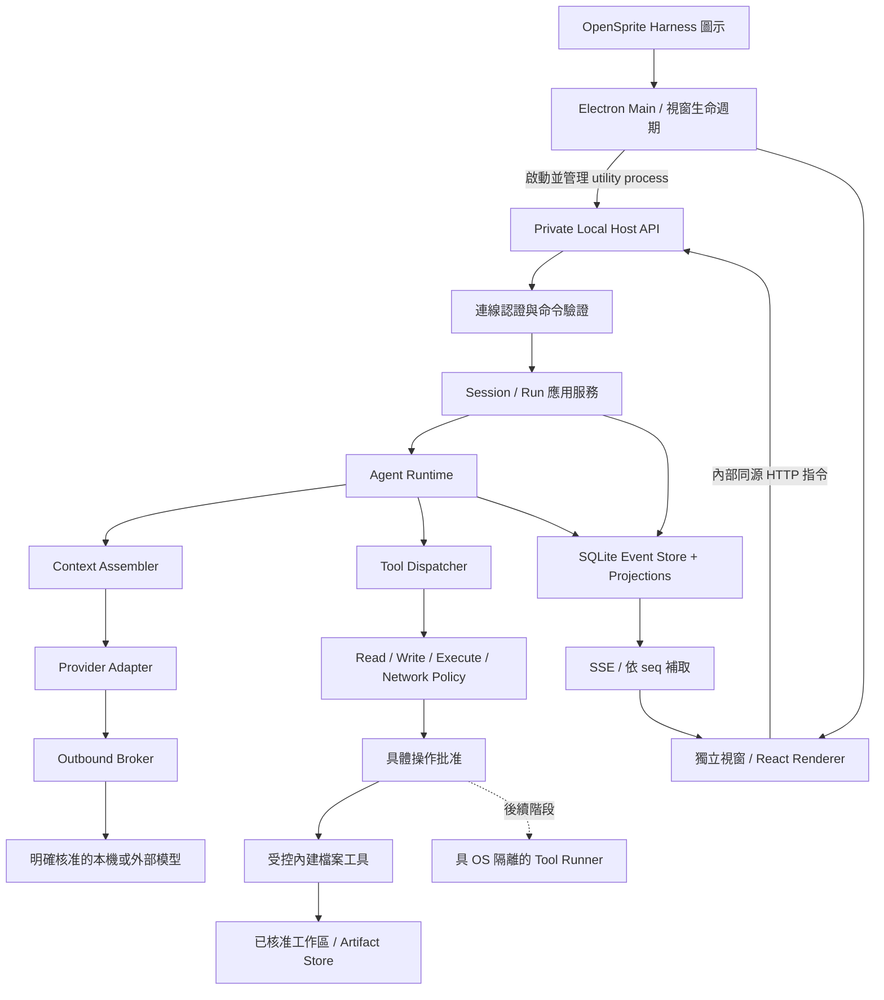
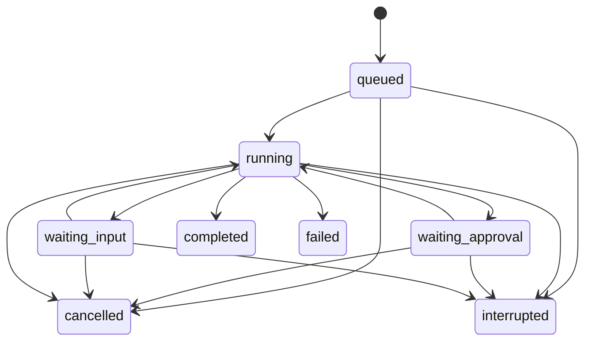

# OpenSprite Harness 架構提案

## 1. 決策狀態與目標

### 已確認的要求

- 正式產品名稱為 **OpenSprite Harness**；程式標題、圖示標籤及安裝包呈現使用此名稱。

- 使用者指定 **TypeScript 核心＋React 前端**。
- **第一版提供桌面應用程式：點 OpenSprite Harness 圖示即開啟獨立視窗，不開系統瀏覽器、不要求手動啟動 server 或輸入網址。**
- 參考分析報告中的 Agent loop、工具流水線、Session 與 provider 分工，實作 OpenSprite Harness 的核心執行框架。
- **不帶入任何向 DeepSeek／參考專案服務上傳的機制**；模型、搜尋、帳號、更新、diagnostics、analytics 等預設服務也不沿用。
- 現在要交付架構與路線圖；本輪不實作產品、不安裝依賴、不 commit／push。
- 規劃開始時確認 OpenSprite Harness checkout 只剩 .git，HEAD 為清空提交 ef23b354；目前新增的只有規劃文件，舊 checkout 架構不作為現行系統。

### 提議的產品範圍

第一個版本為單一使用者、本機執行的桌面 coding-agent 工作台。建議以 Electron 攜帶 React 介面及私有 Host；先完成圖示啟動、獨立視窗、安裝包，再完成模型對話、受控工作區檔案操作、批准、取消、重開會話與失敗恢復。HTTP＋SSE 僅為桌面內部 transport，不代表使用者必須開瀏覽器。第一版不另交付獨立 browser 網頁版。

建議先以 Windows 為主要驗證平台，模組保留 Linux adapter 邊界。沒有通過實測的平台不得標示具有相同隔離保證。

### 暫不納入

- 雲端託管、多租戶、公開網路 API、跨機帳號。
- 任意 Host 插件、可執行 YAML、動態 JS workflow、熱插拔套件市場。
- 第一版任意 shell、MCP executable、PTY、browser/computer use。
- 原專案帳號、更新器、預設 provider、遙測／回饋 collector。
- 模型下載器、自動下載 runtime、全家目錄讀取、Git 自動 commit。
- 分散式 message broker、多個後端 worker、第二套正式事件保存系統。

未來每項能力各自補需求與安全契約，不先建立空的生命周期框架。

## 2. 架構方向與選項

| 選項 | 優點 | 代價 | 本次建議 |
|---|---|---|---|
| TypeScript 模組化單一 Host | React／Host 共享契約；容易追查流程；只有一個寫入擁有者 | 需主動隔離耗 CPU 工作與任意程序 | **採用**；以明確 ports 與 composition root 組裝 |
| 一開始全面插件化 | 可替換所有部件 | 動態權限面、載入順序與卸載複雜；容易把不需要的預設帶入 | 不採；先為確實需要替換的能力定義介面 |
| 多服務／微服務 | 程序與部署邊界清楚 | 本機 IPC、認證、發布與資料一致性負擔高 | 暫不採；只有安全上需要的 runner 另外隔離 |

Python 核心原先僅為討論備選；使用者已選 TypeScript，因此不另建 Python 後端。未來某工具需要 Python 時，只能作為受管理的外部工具 runtime，不能形成另一個核心。

### 建議技術組合

| 層級 | 提議 | 邊界 |
|---|---|---|
| Runtime | Electron 固定版本所攜 Node.js runtime；開發 Node 另鎖相容版本 | Host／SQLite 必須在實際打包的 Electron utility process 測試，不依賴使用者安裝 Node |
| Host | TypeScript strict、ESM、Fastify | HTTP schema 與序列化；不把 framework plugin 當產品權限模型 |
| UI | React＋TypeScript＋Vite；建議 Ant Design | Ant Design 為提議，非已核准 UI 實作；字型／圖示與資源本機打包 |
| Contracts | 版本化 JSON Schema＋由同一來源產生 TS 型別 | 限可信編譯期 schema，不接受外部任意 schema 編譯執行 |
| Persistence | SQLite，WAL＋foreign keys，關鍵提交使用 FULL durability 設定 | driver 依 Electron 內嵌 Node／native ABI、Windows 打包與維護狀態定案 |
| API transport | 桌面 renderer 與私有 Host 的同源 HTTP commands＋SSE | 只綁 127.0.0.1 隨機 port；不開系統瀏覽器、不要求使用者操作網址 |
| Tests | 單元／整合測試＋Playwright 重要使用流程 | 先 fake provider，真實 provider 僅顯式 opt-in |
| Desktop | **第一版**，建議 Electron main＋窄 preload＋sandboxed React renderer | Host 使用受管理 utility process；Tauri 保留為未採用備選，避免現在另加 Rust／sidecar 工具鏈 |

Fastify 官方提醒 schema 編譯屬應用程式碼，不應交給不可信使用者定義；因此契約只從版本庫打包載入。[官方文件](https://fastify.dev/docs/latest/Reference/Validation-and-Serialization/)

## 3. 系統圖與模組責任



圖中的 Outbound Broker 只管理 OpenSprite Harness 自有傳輸。任意程序若不受 OS 限制，可直接繞過它；詳細保證範圍見 [外傳政策](data-egress-policy.md)。

### 3.1 第一階段目錄

以下為提議目錄，尚未建立程式檔。先維持三個共用 workspace packages 與三個 apps，不把每個功能拆成獨立發布套件。

```text
apps/
  desktop/
    src/main/             # 視窗、私有 Host、啟動認證、退出
    src/preload/          # 窄而具型別的原生 API
    packaging/            # 自己的圖示、安裝／解除安裝設定
  host/src/
    bootstrap.ts          # 唯一組裝入口
    lifecycle/            # 啟動、關閉、單程序鎖
    http/                 # 路由、認證、SSE、DTO mapping
  web/src/                # 桌面 renderer 的 React 來源；不是獨立網頁版入口
    app/
    features/
      workspaces/
      sessions/
      conversation/
      approvals/
      providers/
      privacy/
packages/
  contracts/src/          # HTTP/SSE schemas 與傳輸型別
  harness/src/
    domain/               # Session、Run、Step、Attempt、ToolCall
    runtime/              # Agent loop、排程、取消
    context/              # 模型上下文選擇與預算
    tools/                # 定義、dispatch、執行結果
    permissions/          # 政策、批准綁定與撤回
    ports/                # store/provider/files/credentials/runner 介面
  platform/src/
    paths/                # 使用者資料與工作區路徑
    storage/              # SQLite、migration、投影
    files/                # 受控檔案操作與 artifact
    network/              # 唯一網路傳輸、目的地政策
    providers/            # 經審查的固定 provider adapters
    credentials/          # memory store；後續 OS vault adapters
    runners/              # 隔離能力探測與未來程序後端
docs/architecture/
docs/plans/
docs/changes/
```

這裡 contracts、harness、platform 為三個 packages；apps/desktop、apps/host、apps/web 分別是桌面外殼、私有後端、React renderer，三者一起打包成 OpenSprite Harness，不要求使用者分別啟動。若後來 provider／tool 需要獨立部署，再按實際依賴拆分。

### 3.2 依賴規則

- harness 不依賴 Fastify、React、SQLite driver、Node HTTP／fs 或特定供應商 SDK。
- platform 實作 harness ports；host 組裝兩者及 HTTP contracts。
- desktop main 管理視窗、Host 與少量原生操作，不實作第二個 Agent loop 或直接寫 SQLite；preload 只暴露明確操作，不暴露 ipcRenderer、fs、任意 command 或通用 invoke。
- web 只能依賴 contracts 與自己的 UI 程式，不能 import Host、vault、SQLite 或 provider adapter。
- contracts 是 wire schema，不放核心業務流程，不自動暴露完整 domain event。
- 只有 platform/network 可建立產品外部 HTTP 連線；由 import-boundary gate 檢查自有來源碼。
- 內建檔案工具的業務決策在 harness；實際開檔在 platform/files。
- 不建立用途不明的全域 utils／services 或通用 event bus。

## 4. 核心資料模型與不變條件

| 物件 | 用途 | 不變條件 |
|---|---|---|
| Workspace | 人類核准的專案根與政策 | 路徑由 Host 管理；模型不能新增根或修改出口 |
| Session | 對話與持久事件的容器 | 同時最多一個有效 Run；有單調 seq |
| Run | 一次人類要求的執行及其工具循環 | 有預算、固定 provider binding 與取消樹 |
| Step | 一次模型決策＋其工具處理 | 有明確序號與上下文快照 |
| Attempt | 一次實際模型請求 | 斷線重試必須記成新 Attempt；不能假裝只呼叫一次 |
| ToolCall | 模型要求的具體工具操作 | call_id 唯一；參數經驗證；效果不明不得自動重跑 |
| Approval | 人類核准的具體操作 | 綁參數摘要、scope、policy revision、有效期與使用次數 |
| Artifact | 本機附件／大量輸出／產出檔 | 使用邏輯 id／相對路徑，不以任意絕對路徑提供下載 |
| ProviderBinding | 設定的目的地、模型、credential reference | Host 設定；模型／repo 內容不能修改 |
| PolicyRevision | 可讀、可寫、執行與網路授權版本 | 權限變更使未執行批准與待送請求重新驗證 |

核心類型採 discriminated unions；JSON／process／wire 邊界作 runtime validation，不以 TS 型別取代不可信輸入檢查。

### 4.1 Run 狀態



- terminal state 只能結算一次，以資料庫條件更新避免取消與完成競爭。
- UI 斷線不會重建 Run；使用者可重連或發出 cancel。
- Host 重啟把未結算 Run 標記 interrupted，保留原因，不自動重送訊息或重做工具。
- pending approval 重啟後失效，需重新核對政策與操作內容。
- 取消僅保證停止後續排程並嘗試中止已啟動工作，不能撤回已送出的資料或已完成的檔案變更。

## 5. Agent 執行流程

1. API 驗證人類輸入、Session、provider、workspace policy 與 budget。
2. 接受 Idempotency-Key；同一命令重送回傳同一 Run，不再次執行。
3. 同一交易寫 user.message、run.queued、更新 projection，再由 scheduler 領取。
4. Context Assembler 從正式事件選擇必要對話，納入已批准讀取的工具結果／附件。
5. 記錄 context snapshot、內容 digest、工具 schema revision、policy revision 與 provider binding；凍結本次請求。
6. Adapter 只能取得 PreparedModelInput，無 EventStore、credential、檔案或任意 URL 存取權。
7. Outbound Broker 再核對授權與目的地，取出與該 destination 綁定的 credential，建立固定 schema 的 request。
8. stream delta 供 UI 即時呈現；依 buffer／時間界線批次保存已接收輸出，不逐 token 開交易。
9. 成功提交 assistant.message；失敗或取消保存 attempt 結算及實際已保留的部分輸出，不假稱遺失 token 已落盤。
10. 工具呼叫經 schema → policy → approval → execute → post-process → result。
11. 工具結果提交後有下一步才繼續；否則 Run completed。

### 5.1 模型紀錄與本機紀錄分離

| 項目 | 可否送給模型 |
|---|---|
| 人類選擇的必要 prompt、對話歷史、工具 schema | 可，受 provider 與資料範圍授權 |
| 明確納入的檔案節錄、已允許工具結果 | 可；畫面顯示將送至哪個 provider |
| canonical event log、所有 Session metadata | 不可直接序列化送出 |
| provider secret、browser cookie、原始 request headers | 不可 |
| analytics id、CPU/RAM、裝置 id、使用行為 | 無此收集／上傳功能 |
| 其他 Session、未選附件、整個使用者資料目錄 | 不可隱含加入 |
| 工具結果內的秘密／絕對路徑 | 適用讀取政策、最小內容與遮罩；無法保證自由文字自動辨識全部秘密 |

模型可能需要合理的先前對話，不應把「禁止額外 Session log」錯解為模型沒有任何記憶。PreparedModelInput 明列本次送出的內容集合，不能另開 metadata extension 夾帶事件。

### 5.2 失敗與重試

- provider 未設定或被拒絕：明確報錯，沒有隱藏 default／fallback。
- timeout、429、斷線需分類；已送出的 request 可能計費，不能宣稱 exactly-once inference。
- 第一版不在已開始 stream 後自動重試；UI 讓人類決定新 Attempt。
- 有安全且可證明的 pre-send 失敗可按明確 budget 重試，目的地不變，重試前重驗授權。
- context 摘要只保存在本機；若需要模型產生摘要，顯式使用已批准 provider，同樣受資料政策限制。
- 工具錯誤不把 stack、env 或 secret 直接傳給模型；回傳具體且已遮罩的錯誤類型。

## 6. 工具、批准與隔離

### 第一個可用版本的工具

| 工具 | 效果 | 前提 |
|---|---|---|
| read_file、list_files | workspace read | 明確讀根；封鎖 OpenSprite Harness 資料根與憑證位置 |
| search_files | workspace read | 第一版由受控檔案遍歷；是否改獨立 rg 在程序政策就緒後決定 |
| propose_patch | 無檔案變更 | 產生 diff／預期檔案 hash |
| apply_patch | workspace write | 人類核准內容＋路徑＋舊 hash；執行前再次核對 |
| present_artifact | 本機呈現 | 僅已登記 artifact，無任意 URL／路徑 |
| request_user_input | 等待人類 | 問題與選項有大小限制，不能當作權限提升 API |

第一版沒有自動檔案刪除、任意 shell、任意 HTTP、Git push 或插件安裝工具。

### 執行規則

- 工具宣告 effect 只是 schema；Host 必須按實作定義重新核對，不能相信模型說「這是 read-only」。
- 初期每 Session 工具串行；通過一致性測試後，唯讀工具可用小型有界 pool。
- 寫入與未來程序工具形成 barrier；結果按模型 tool-call 順序提交。
- 同一 workspace 不同 Session 的 mutation 使用共享排他協調，避免彼此覆寫。
- Approval 綁 run_id、call_id、arguments_hash、roots、policy_revision、expiry；任何一項變動需重批。
- 一次批准不等於永久授權，模型不能發 API 替人類批准。
- 路徑使用 canonical root／實際開啟物件檢查；初期拒絕 symlink/reparse point。對 hard-link／TOCTOU 無法可靠處理的環境，拒絕敏感操作或改用隔離的工作區副本，不能只做字串 startsWith。
- 內建檔案功能面對不可信 repo 內容；不宣稱能阻止同使用者權限的惡意程序篡改 Host。

### 後續 Tool Runner

RunnerPort 回報 filesystem/network/process-tree 隔離能力與測試 profile。只有滿足所請求保障，才允許任意程式工具。

worker_threads、node:vm、child_process 或 Node permission flags 本身都不能視為惡意程式隔離。Node 官方明確區分 permission model 與防惡意碼的安全邊界。[官方文件](https://nodejs.org/api/permissions.html)

Windows 若尚無經驗證的合適 OS／容器後端，shell／MCP 保持不可用；不能靜默改用一般 pwsh 並顯示 sandbox enabled。Linux 也需實測讀寫、網路與 descendant 限制；只限制 filesystem 不夠。

## 7. 保存、事件與恢復

### 7.1 唯一正式紀錄

SQLite 是 Session／Run 的正式來源；JSONL 僅供顯式匯出，不雙寫成第二個權威系統。

| 表 | 主要內容 |
|---|---|
| workspaces | id、root reference、policy revision |
| sessions | title、workspace_id、最新 seq、state |
| runs | session_id、status、provider binding snapshot、budget |
| session_events | session_id＋seq 唯一、event_id、version、type、run_id、time、payload |
| tool_calls | call_id、args digest、status、started/result reference |
| approvals | operation binding、state、expiry |
| artifacts | id、digest、relative storage key、size、media type |
| provider_configs | destination reference、model、credential reference；無 key |
| policy_revisions | 版本化授權快照 |
| schema_migrations | 單調版本與已執行 migration |
| command_receipts | command id／idempotency key／結果 id |

- append 領域事件與更新相關 projection 在同一 SQLite transaction。
- publish 在 commit 後，禁止向 UI 宣告尚未保存的正式成功。
- projection 可從事件 rebuild；derived context 亦要知道自己的來源 seq。
- Session event 版本與資料庫 schema 版本分開，未來格式不能猜測解碼。
- 不建立 diagnostics_outbox、telemetry_queue、delivery watermark 或歷史補送 job。
- DB、附件與本機 log 都視為敏感，不能只保護 credential store。

SQLite WAL 允許 reader 與 writer 並行，但同時只有一個 writer；因此規劃單一 Host 擁有寫入，DB 放本機檔案系統，不放網路磁碟。[官方文件](https://www.sqlite.org/wal.html)

### 7.2 事件投遞與 SSE

- durable envelope：event_id、session_id、seq、event_version、type、run_id、time、payload。
- 同 Session 內 seq 唯一單調；前端依 seq 去重。
- SSE Last-Event-ID 使用該 Session 的持久 seq，重連補取，不能重啟 Run。
- live token delta 是短期 channel，帶 attempt_id／delta index；不冒用 durable seq。掉線先補 durable events，再視是否仍有 buffer 取得 delta；超出 buffer 從已保存快照重畫。
- slow client 有 buffer 上限；壓力過大斷開並要求重取，不能讓無界佇列拖垮 Host。
- replay 是讀取紀錄，不是重播工具副作用。

### 7.3 崩潰與未知結果

tool.started 已提交但沒有 result 時，啟動恢復標記 outcome_unknown。人類先檢查工作區再決定新操作；不因「沒有 result」就認定沒有寫檔。

本機 file write 可用 preimage hash／預期 postimage hash／原子置換協助對帳，但不將這個方法泛化為任意 shell、外部付款或遠端操作的 exactly-once。

取消樹、worker exit 與 persisted result 不一致時保留證據，優先停止後續工作。

## 8. API 契約提案

JSON 契約帶 api_version；錯誤以 code、request_id、message、retryable、details 輸出，details 不含 secret 或原始 stack。

| Method / path | 用途 | 限制 |
|---|---|---|
| GET /api/v1/health | 最小健康與 readiness | 不輸出環境／憑證／絕對路徑 |
| POST /api/v1/workspaces | 人類登記工作區 | 需 Host 驗路徑；模型沒有此權限 |
| GET/POST /api/v1/sessions | 列表／建立 Session | 屬本機 owner |
| GET /api/v1/sessions/:id | 狀態與 conversation snapshot | 分頁／大小上限 |
| POST /api/v1/sessions/:id/messages | 接受人類輸入與建立 Run | Idempotency-Key；Session busy 回 409 |
| GET /api/v1/sessions/:id/events | SSE durable events＋有界 live deltas | cookie 認證、seq 補取 |
| POST /api/v1/runs/:id/cancel | 取消 | 冪等；不宣稱撤銷既有副作用 |
| POST /api/v1/approvals/:id/decision | 人類批准／拒絕 | 綁具體操作；不接受模型直接呼叫 |
| GET/PUT /api/v1/providers/:id | 目的地／模型與狀態 | GET 不回傳 secret |
| PUT/DELETE /api/v1/providers/:id/credential | 設定／清除憑證 | 沒有原始 key 的 GET |
| GET /api/v1/privacy/status | 有效出口政策與隔離能力 | 顯示實際限制，不只顯示設定值 |
| GET /api/v1/artifacts/:id | 本機 artifact | 驗 id，禁止路徑穿越，限制 inline MIME |

前端與 Host 透過 contracts 共用 schema；TypeScript 型別不能取代 API 驗證。實作時再寫固定 OpenAPI，不先發佈未存在端點。

### 桌面啟動、認證與程序邊界

1. 點圖示啟動 Electron main，取得桌面 single-instance lock；再次啟動聚焦現有視窗，不建立第二個 Host。
2. main 顯示打包的本機啟動畫面，啟動自己的 Host utility process，透過私有 IPC 接收 ready／fatal／shutdown 訊息；env 採白名單，啟動訊息不含 provider key。
3. Host 取得資料根單程序鎖、開 SQLite、綁 127.0.0.1:0，再以私有 IPC 回傳實際 origin 及一次性 bootstrap secret；若失敗，視窗顯示具體錯誤，不開瀏覽器補救。
4. main 僅向該受管理 Host 的 bootstrap route 交換認證，將 HttpOnly、SameSite=Strict、短期 cookie 放入該視窗的獨立記憶體 session。secret 不進 renderer、URL、log 或磁碟；cookie／server 驗證綁定此次 instance 與 authority，不能把其他 localhost port 當同一服務。
5. BrowserWindow 載入自己 Host 提供的打包 React 資源，以同源 HTTP＋SSE 操作 Harness。main／Host 不呼叫 openExternal 或系統預設瀏覽器啟動應用。
6. Host／Origin allowlist、state-changing CSRF 與 SSE cookie 驗證維持；cookie 不因「只在桌面用」就省略。開發 Vite origin 僅在 dev 配置開放，production 不依賴 dev server。

HTTP cookie 本身不以 TCP port 區隔。instance／authority 綁定要由 renderer request／navigation allowlist、Host 驗證與 cookie 內容驗證共同執行，不能把隨機 port 或 cookie 屬性當作 port 隔離。

Electron utility process 是受信任 Host 的程序分離，不是任意工具的安全沙箱。Electron renderer 的 sandbox 也不能代替工具 runner 的 filesystem／network 隔離。

### 桌面視窗與 IPC

- renderer 明確設定 nodeIntegration=false、contextIsolation=true、sandbox=true、webSecurity=true；維持嚴格 CSP，只載入自己的資源與 Host。
- 窄 preload 僅提供必要的原生目錄選擇、應用版本／啟動狀態等具名方法。IPC 驗 sender webContents、主 frame、精確應用 origin、payload 與人類操作範圍，不只比較 URL 字串前綴。
- 一般流程用 HTTP／SSE；不透過 preload 提供任意 HTTP proxy、任意檔案存取或 shell。原生目錄選擇結果仍由 Host 核對，才建立 Workspace。
- 禁止任意視窗導向、window.open、webview 與新外部視窗。外部連結不自動開；若未來支援，需人類明確操作、驗 HTTP(S) URL，不附帶 token／Session。
- release 不開 DevTools／remote-debugging port，不啟用 crashReporter、analytics、版本檢查或 auto-updater；全部程序都納入出口觀測。
- Chromium 權限請求、任意下載預設拒絕，不能藉原生 API 或 navigation 開出第二條任意網路／檔案通道。
- 第一次啟動可顯示未設定模型的工作台，不自動探測模型或下載 runtime。

### 關閉、崩潰與發布

- 第一版採單主視窗，關閉即退出；沒有預設托盤常駐、開機自啟或關窗後繼續工作。
- 有活躍 Run 時提供「返回工作台／停止並退出」；退出時停止排程、取消 Run、結算已知狀態、關閉 SQLite、終止所擁有 Host／工具程序。等待逾時有明確提示與記錄，效果未知者保留 outcome_unknown。
- Host crash 不無限自動重啟／重送任務；顯示本機錯誤與重新啟動選項。renderer reload 重連同一 Host，不建立第二個 Run；main 意外退出的 orphan 處理要在打包流程測試。
- Windows 第一版交付離線可安裝的 per-user 安裝包、自有 OpenSprite Harness 圖示、開始功能表及桌面捷徑。攜帶 Electron／Host／renderer／SQLite 相依，不要求全域 Node、pnpm、Vite 或終端操作；本機／遠端模型仍由使用者另行設定，不與桌面 runtime 混為一談。
- 安裝包完整性、Electron／native module ABI 與簽章在發布 gate 驗證；沒有簽章的開發測試包要明示，不能當已簽正式版。更新先走人類下載自己產品的新安裝包，不繼承任何原服務更新機制。
- Linux 保留相同程序契約，安裝格式與生命週期另驗，未通過前不承諾與 Windows 同時發布。

Electron 的安全建議包括 renderer isolation、IPC sender 驗證與限制 navigation；utilityProcess 可承載受管理的 Node 子程序，適合作為本提案的私有 Host 載體。[安全文件](https://www.electronjs.org/docs/latest/tutorial/security)；[utilityProcess](https://www.electronjs.org/docs/latest/api/utility-process)；[打包文件](https://www.electronjs.org/docs/latest/tutorial/application-distribution)

## 9. 使用者資料與憑證

提議唯一產品資料根：Windows %USERPROFILE%/.opensprite、Linux ~/.opensprite。PathResolver 統一取得；一般功能不能自行拼家目錄。

```text
.opensprite/
  config/                  # provider 與 policy，無 secret
  data/opensprite.sqlite
  artifacts/<id>/
  attachments/<id>/
  logs/                    # 遮罩後本機診斷
  runtime/                 # lock／短期非機密狀態
  desktop/                 # Electron userData、session/cache、本機 crash dump
```

依首次真正使用建立目錄，程式安裝與產品資料分開。Workspace path 是使用者選擇的工作資源，與產品資料根不同。

在建立 Electron session／window 前，將 userData、sessionData、cache 與 crash dump 導向 PathResolver 管理的 desktop 區域；認證使用非持久 session。安裝／解除安裝不靜默清除 .opensprite，清除資料需另行明確選擇。

CredentialStore 第一階段 memory-only；需要記住 key 時才加入獨立 OS vault adapter 提案。不得因 vault 不可用而退回明文 JSON/YAML。OS vault 詳見 [外傳政策](data-egress-policy.md#6-憑證與本機資料)。

單一 Host 寫入，使用單程序鎖，第二個 Host 明確報錯；不開多 worker 或兩個安裝同時寫同一根。

## 10. UI 規劃

- 第一個 UI 驗收就是「安裝後點 OpenSprite Harness 圖示，在獨立視窗進入工作台」，不用開 browser／終端或輸入 localhost URL。
- 左側 Workspace／Session 清單；中央對話／工具進度；側面按需顯示 diff、artifact、批准。
- 設定先只有 Providers、Permissions、Data & Privacy、Local storage，不建立無功能的 telemetry 開關。
- Provider 首次使用顯示實際 origin、是否本機／遠端、資料範圍與 key 保存方式。
- 每個 Run 能檢視輸入 context 的檔案／訊息來源與傳送目標；預設不直接展示／保存原始 secret。
- 工具批准顯示具體路徑、diff、目的地、效果；不要只寫「允許工具」。
- interrupt／unknown outcome 與一般失敗分開呈現；重新執行需明確操作。
- SSE 斷線不假裝 Run 已停止；顯示重連與最後持久 seq。
- 所有字型、icon、CSS、腳本本機 bundle；遠端圖片／HTML 資源不自動載入。
- HTML／Office／PDF viewer 延後至獨立安全設計；先純文字／Markdown／code／diff。
- 無 crash-report sender、feedback uploader、DeepSeek 帳號或原產品更新 UI。

Ant Design 提供 React／TypeScript 的基礎元件，作為提議的 UI 庫；不需要再同時引入第二套大型 UI。[官方介紹](https://ant.design/docs/react/introduce/)

## 11. 擴充次序

1. 穩定單 Agent 與 first-party tools。
2. context budget、spill、摘要、版本遷移／backup。
3. 優先驗證具 OS 隔離的程序工具，讓單 Agent 可執行受控 build／test。
4. read-only subagents：獨立 Session／Run、選擇性 context snapshot、共用根預算及取消樹；寫入 child 需另加 mutation coordinator／獨立 worktree。
5. 程序隔離與出口就緒後，才考慮 MCP／browser tools。
6. 排程作本機人類明確任務，重啟需重驗 destination／policy，不作任何診斷補送。
7. SDK 及額外 Desktop 原生功能後續按需加入；桌面外殼與安裝包已是第一版內容，永遠共用同一 Host 契約及 Agent loop。

child 權限＝parent 可授予權限與 child preset 的交集；子代理不能新增 provider／credential／出口，也不能以 spawn 避免根 budget。

上列是建議交付優先序，不是唯讀子代理的技術強依賴。若目標平台的任意程序隔離尚未就緒，階段 5 保持 unavailable，仍可另做只使用原有受控內建工具的階段 6；不能藉此放行 child 的任意程序工具。

## 12. 驗收、來源與下一步

階段與完成條件見 [路線圖](../plans/harness-roadmap.md)，出口要求見 [資料外傳與權限政策](data-egress-policy.md)。

參考來源：

| 報告中的觀察 | OpenSprite Harness 對應設計 |
|---|---|
| 第 6 節：event log 驅動 Agent／tool 流程 | 自己的 Run 狀態機、明確介面與 SQLite 事件；不依賴其 Core packages |
| 第 7 節 R1：adapter 夾帶 Session log | PreparedModelInput 固定 schema，adapter 不持有 EventStore |
| 第 7 節 R2／R3：獨立回饋及 Desktop 上報 | 不建立任何 sender／outbox；回饋只存本機 |
| 第 8 節 R4：高權限 Inspector | 無產品 Inspector；未來除錯需獨立認證與設計 |
| 第 8 節 R5：明文憑證 | 先 memory-only；後續 vault 不降級明文 |
| 第 8 節 R6／R7：sandbox 與可信插件邊界 | 四類權限＋runner capability gate；不提供任意 Host 插件／可執行設定 |
| 第 13.0 節：不要上傳到原服務 | 預設空允許清單、拒絕已知原服務、無 fallback、全載體驗收 |

- 本機 DeepSeek Harness 分析報告 REPORT.zh-TW.md（2026-10-19；來源提交 687f282e），特別第 6、7、8、13 節。只參考觀念與風險，不直接依賴其 base bundle／套件。
- [Fastify validation/serialization](https://fastify.dev/docs/latest/Reference/Validation-and-Serialization/)
- [Node.js permissions](https://nodejs.org/api/permissions.html)
- [SQLite WAL](https://www.sqlite.org/wal.html)
- [Ant Design React](https://ant.design/docs/react/introduce/)
- [Electron security](https://www.electronjs.org/docs/latest/tutorial/security)
- [Electron utilityProcess](https://www.electronjs.org/docs/latest/api/utility-process)
- [Electron packaging](https://www.electronjs.org/docs/latest/tutorial/application-distribution)

尚需在實作開始前鎖定：Electron／內嵌 Node 與開發工具版本、SQLite driver 與 native ABI、安裝打包工具、第一個實際模型 endpoint、是否需要持久憑證、Windows 任意工具程序隔離後端。這些未定項不妨礙本次架構提案，但不能被當成已實作或已通過測試。

## 13. 決策摘要

| 項目 | 狀態 |
|---|---|
| 正式產品名稱 OpenSprite Harness | 使用者已確認 |
| TypeScript core＋React | 使用者已確認 |
| 第一版獨立桌面視窗、圖示啟動、不開 browser | 使用者已確認 |
| Electron main／preload／renderer＋私有 Host utility process | 本提案建議；選定版本與 ABI 待驗 |
| 不向 DeepSeek／原服務傳送 | 使用者明確要求，不能當成可選預設 |
| 單一本機 Host、SQLite、HTTP＋SSE、模組邊界 | 本提案建議，待審閱 |
| 先無任意 shell／MCP、無 Host 動態插件 | 為滿足出口要求的建議分期 |
| Fastify／Vite／Ant Design | 工程建議，尚未安裝 |
| 可執行產品、安全驗證、commit／push | 本輪沒有執行 |

## 14. 變更記錄

| 版本 | 日期 | 內容 |
|---|---|---|
| 0.3 | 2026-10-19 | 正式產品名稱統一為 OpenSprite Harness；保留儲存庫資料夾與 .opensprite 路徑 |
| 0.2 | 2026-10-19 | 依使用者要求將桌面入口提前至第一版；補 Electron 邊界、內部認證、視窗／退出、安裝包與驗收 |
| 0.1 | 2026-10-19 | TypeScript／React、單 Host、事件保存與出口政策初稿 |
